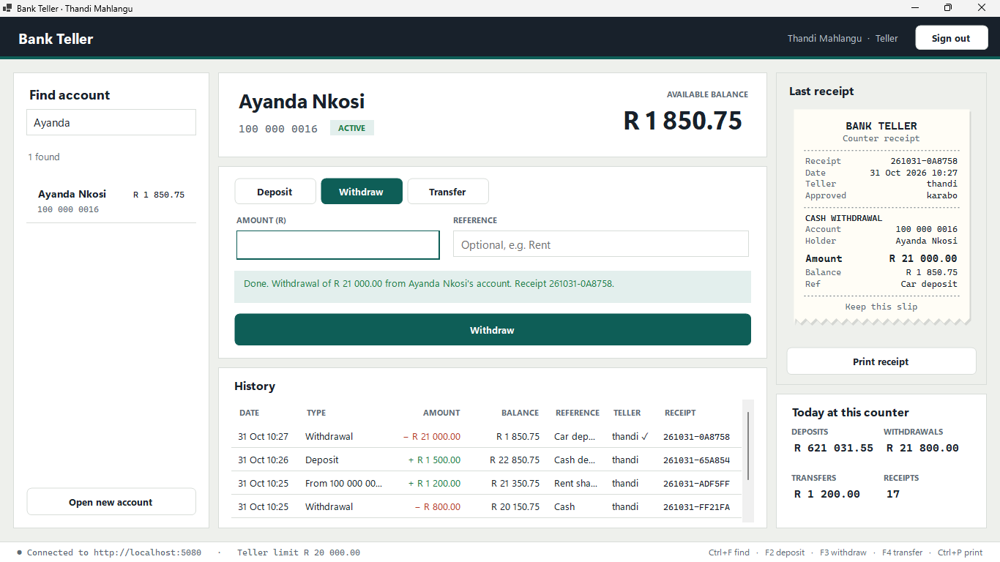
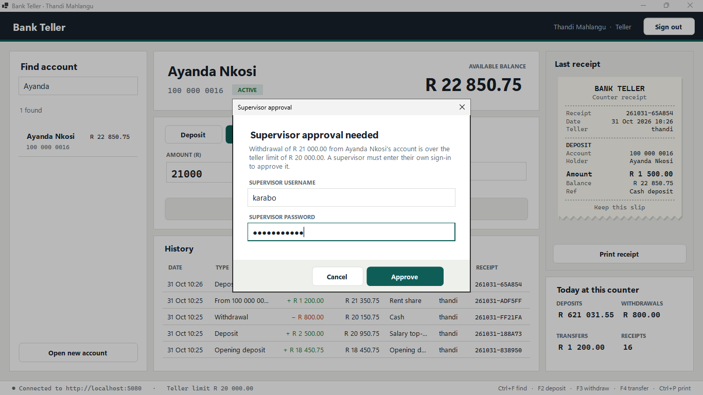
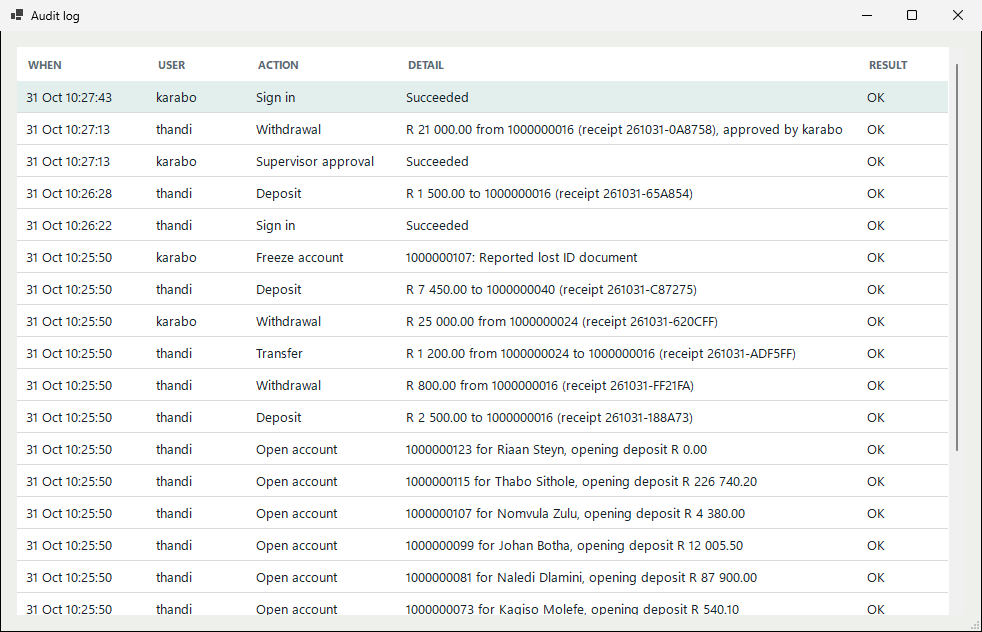

# Bank Teller


A client-server counter system for bank tellers, written in **VB.NET on .NET 10**. A Windows Forms desktop client talks to an **ASP.NET Core Web API** that owns all the business rules, security and data, stored in **SQLite**.

Tellers sign in, find a customer, and post deposits, withdrawals and transfers. Each one prints a receipt and is written to an audit log. Withdrawals and transfers over the teller limit need a supervisor to approve them with their own credentials.



## Features

**At the counter**
- Find accounts by holder name or account number, and open new accounts.
- Deposit, withdraw and transfer. The action button names exactly what will happen ("Withdraw R 21 000.00").
- Transfers show the recipient's name before you post, so money doesn't go to the wrong account.
- Account numbers carry a Luhn check digit, so a mistyped digit is caught as you type.
- Debits from R 5 000 ask for confirmation. Errors appear inline, not in pop-ups.
- Every transaction produces a receipt that can be printed (80 mm slip, with print preview).
- Account history with credits and debits colour-coded, plus the teller's totals for today.
- Keyboard shortcuts: Ctrl+F find, F2/F3/F4 deposit, withdraw, transfer, Ctrl+P print.

**Supervisors**
- Approve over-limit withdrawals and transfers. The approver's name goes on the receipt and in the history.
- Freeze and unfreeze accounts, with a reason. Frozen accounts reject every posting.
- View the audit log of sign-ins (including failed ones), approvals, postings and account changes.

| Supervisor override | Audit log |
| --- | --- |
|  |  |

## Security and data integrity

| Concern | How it is handled |
| --- | --- |
| Passwords | Salted PBKDF2-SHA256 (600 000 iterations), compared in constant time. The hash format records its work factor, so it can be raised later. |
| Password guessing | Lockout after 5 failed attempts for 15 minutes, plus a per-address rate limit on sign-in. Unknown usernames and wrong passwords get the same message and cost the same time. |
| Sessions | 30-minute signed JWTs with roles (Teller, Supervisor). The client signs out after 5 minutes idle, or when the token expires. |
| Authorisation | Every endpoint requires a signed-in user by default. Supervisor-only actions are enforced by the API, not just hidden in the client. |
| Money | Stored as whole cents (integers), never floating point. Amounts with fractions of a cent are rejected, and a database `CHECK` prevents negative balances. |
| Concurrent tellers | Each posting is one SQLite write transaction (`BEGIN IMMEDIATE`). A test fires 20 simultaneous R100 withdrawals at R1 000: exactly 10 succeed and the balance ends at exactly R0.00. |
| Double posting | Every transaction carries an `Idempotency-Key`. A retry (double click, timeout, or re-sending with a supervisor's approval) returns the original receipt instead of posting again. |
| Injection | All SQL is parameterised. Search input is escaped for `LIKE`, so `%` and `_` match literally. |
| Errors | Rule violations return RFC 7807 problem responses with a machine-readable `code`. Unexpected errors are logged on the server and return a generic message, never a stack trace. |
| Secrets | The JWT signing key comes from configuration (`Jwt__Key`). In production the API refuses to start without one. |
| Audit | Sign-ins, approvals, postings and freezes are written in the same transaction as the change they describe. |

## Architecture

```
┌────────────────────────┐   HTTPS + JSON    ┌───────────────────────────────┐
│  BankTeller.Desktop    │  Bearer token     │  BankTeller.Api               │
│  WinForms client       │ ────────────────► │  ASP.NET Core Web API         │
│  sign-in, counter,     │  Idempotency-Key  │  controllers → services       │
│  receipts, audit view  │ ◄──────────────── │  auth, rules, audit           │
└───────────┬────────────┘   problem+json    └───────────────┬───────────────┘
            │                                                │ parameterised SQL
            └──────── BankTeller.Shared ─────────┐           ▼
                      contracts, Money,          │     SQLite (WAL)
                      AccountNumber              │     tellers · accounts ·
                                                 │     transactions · audit_log
                                                 └──── used by both sides
```

```
src/
  BankTeller.Shared/    request/response contracts, Money and AccountNumber helpers
  BankTeller.Api/       Program.vb (hosting, JWT, rate limiting, error handling)
    Controllers/        Auth, Accounts (postings, freeze, history, audit)
    Services/           AuthService (sign-in, lockout, approvals), AccountService, AuditLog
    Security/           PasswordHasher, TokenService
    Data/               schema, SQL helpers, demo data
  BankTeller.Desktop/   LoginForm, MainForm, dialogs, ReceiptView, ApiClient, Theme
tests/
  BankTeller.Tests/     41 xUnit tests: unit tests plus in-memory HTTP tests of the real API
```

### API

| Method | Endpoint | Who |
| --- | --- | --- |
| `POST` | `/api/auth/login` | anyone (rate limited) |
| `GET` | `/api/accounts?query=` | tellers |
| `GET` | `/api/accounts/{number}` · `/api/accounts/{number}/transactions` | tellers |
| `POST` | `/api/accounts` (open an account) | tellers |
| `POST` | `/api/accounts/{number}/deposits` · `/withdrawals` | tellers, `Idempotency-Key` required |
| `POST` | `/api/transfers` | tellers, `Idempotency-Key` required |
| `GET` | `/api/tellers/me/summary` | tellers |
| `POST` | `/api/accounts/{number}/freeze` · `/unfreeze` | supervisors |
| `GET` | `/api/audit` | supervisors |

In development, the OpenAPI document is served at `/openapi/v1.json`.

## Running it

Requires the [.NET 10 SDK](https://dotnet.microsoft.com/download) on Windows (the desktop client is Windows Forms).

Start the API. In development it creates `bank.db` and seeds fictional customers on first run:

```bash
dotnet run --project src/BankTeller.Api --launch-profile BankTeller.Api
```

Then start the desktop client in a second terminal:

```bash
dotnet run --project src/BankTeller.Desktop
```

Sign in with a demo account. Both use the development password `Teller#2026`, set in `appsettings.Development.json` and only used when seeding a development database.

| Username | Role |
| --- | --- |
| `thandi` | Teller (limit R 20 000) |
| `karabo` | Supervisor |

To run the API outside development, set a signing key and turn off demo data:

```bash
set ASPNETCORE_ENVIRONMENT=Production
set Jwt__Key=<a random secret of at least 32 characters>
dotnet run --project src/BankTeller.Api
```

## Tests

```bash
dotnet test --project tests/BankTeller.Tests
```

The 41 tests cover:
- Account-number check digits, money conversion and password hashing.
- The real API in memory against a throwaway SQLite file:
  - Lockout and its expiry, using a fake clock.
  - Identical answers for unknown users and wrong passwords.
  - Idempotent retries.
  - Overdraft and limit rules, and supervisor approval and rejection.
  - Transfers, frozen accounts and role checks.
  - Hostile search input.
  - The concurrency race described above.

GitHub Actions builds the solution and runs the tests on every push.

## What changed from the first version

The original (2013, .NET Framework 4.5) was a single form that read and rewrote a comma-separated `accounts.dat` file. It had no sign-in, no history, and session totals that were lost on close. A crash during a save could corrupt the file, and two people using it at once could overwrite each other's balances. This rebuild:
- Moves the rules behind an authenticated API with a transactional database.
- Adds roles, approvals, an audit trail and idempotent postings.
- Replaces the form with a full counter client.
- Puts the whole system under automated tests.

All customer data is fictional.

## Author

**Sizwe Ramokhali**, Software Developer
